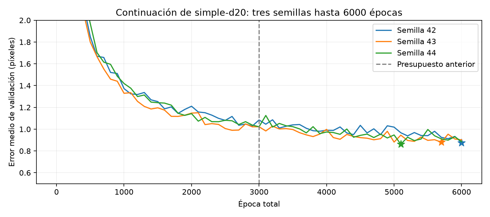

# TP5 1.b — Continuación de la ganadora hasta 6000 épocas

Arquitectura: `35→40→20→20→20→40→35` (`simple-d20`). Se continuaron las semillas 42, 43 y 44 desde su último checkpoint de época 3000, con pesos, momentos y contador de Adam, RNG e historia conservados.

**Validación media: 1.01354 → 0.87313 píxeles por imagen (13.85 % de reducción).** Representante: `simple-d20-seed-44`.

Se consumieron **9000 épocas adicionales**: 3000 por semilla, hasta 6000 totales. Tiempo de continuación: **10.50 minutos**. No se entrenaron otras arquitecturas ni se cambiaron tasa, pérdida, ruido o lotes.

## Checkpoints por semilla

| Semilla | Mejor época hasta 3000 | Error anterior | Mejor época hasta 6000 | Error nuevo |
|---|---:|---:|---:|---:|
| 42 | 2900 | 1.02885 | 6000 | 0.87688 |
| 43 | 2600 | 0.98948 | 5700 | 0.88063 |
| 44 | 3000 | 1.02229 | 5100 | 0.86188 |



Se compara el mejor checkpoint disponible bajo cada presupuesto, no solo las últimas épocas. Se conservaron los mejores anteriores como candidatos. El ruido continúa con la época absoluta (3001–6000), sin reiniciar su secuencia. La selección mantiene el promedio por igual de errores de 0,05/0,10/0,20; desempata MSE y luego época más temprana. El representante desempata por semilla.

## Evaluación independiente con ruido nuevo

Colección nueva: semilla **20261118**, 12.832 imágenes sobre los mismos 32 caracteres. Se generó después de congelar la selección. Ambos presupuestos se evalúan sobre exactamente las mismas entradas; los valores son medias de tres semillas. p=0,30 está fuera del rango entrenado. No se estima generalización a caracteres nuevos.

| Presupuesto | Ruido p | Error medio | Recuperación exacta | Con ≤1 error |
|---|---:|---:|---:|---:|
| 3000 | 0 | 0.00000 | 100.00 % | 100.00 % |
| 3000 | 0.05 | 0.06656 | 97.00 % | 98.20 % |
| 3000 | 0.1 | 0.37802 | 87.27 % | 91.62 % |
| 3000 | 0.2 | 2.60917 | 49.19 % | 57.45 % |
| 3000 | 0.3 | 6.62052 | 16.06 % | 22.09 % |
| 6000 | 0 | 0.00000 | 100.00 % | 100.00 % |
| 6000 | 0.05 | 0.04125 | 98.15 % | 98.83 % |
| 6000 | 0.1 | 0.27854 | 91.38 % | 93.83 % |
| 6000 | 0.2 | 2.31969 | 56.17 % | 63.38 % |
| 6000 | 0.3 | 6.32760 | 20.32 % | 26.21 % |

## Verificaciones y reproducción

Se recalculó la validación de los tres modelos elegidos, se comprobó que las primeras 3000 épocas de las historias sigan idénticas y que Adam alcance 6000 actualizaciones. Todos los archivos de la campaña anterior conservan sus SHA256. La prueba automatizada contrasta una continuación corta con entrenamiento ininterrumpido, incluidas las predicciones y los momentos de Adam.

Desde `tp5/`, para repetir el experimento en una salida nueva (consume otras 9000 épocas):

```powershell
python -m src.denoise_continuation run --source results/denoising-architectures-2026-11-17 --output results/denoising-6000-reproduction
```

Para recalcular únicamente la evaluación, sin entrenar:

```powershell
python -m src.denoise_continuation evaluate --campaign results/denoising-6000-2026-11-17 --output results/denoising-6000-evaluation-reloaded
```

El fundamento del DAE sigue siendo el par entrada contaminada/objetivo limpio (OFF-022, p. 22). El presupuesto de 6000 épocas es una decisión experimental autorizada por el usuario. Esta comparación no demuestra convergencia definitiva.

La evaluación se repitió sin entrenar: **11 arrays**, la tabla CSV y las métricas resultaron idénticos. [Verificación](validation/reload-comparison.json).

Pasaron **41 tests** del TP5. [Log](validation/tp5-tests.log).
