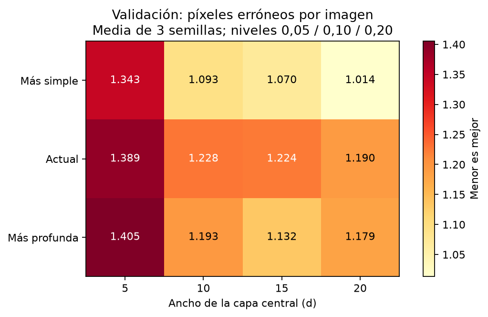
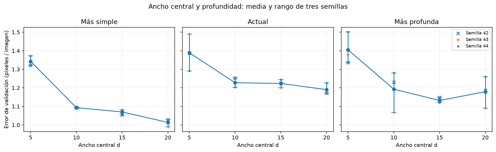
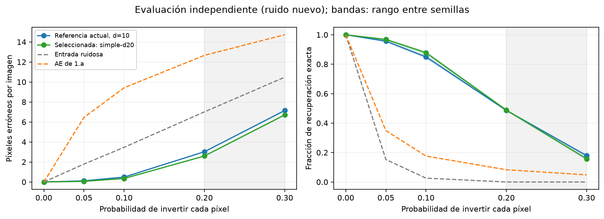
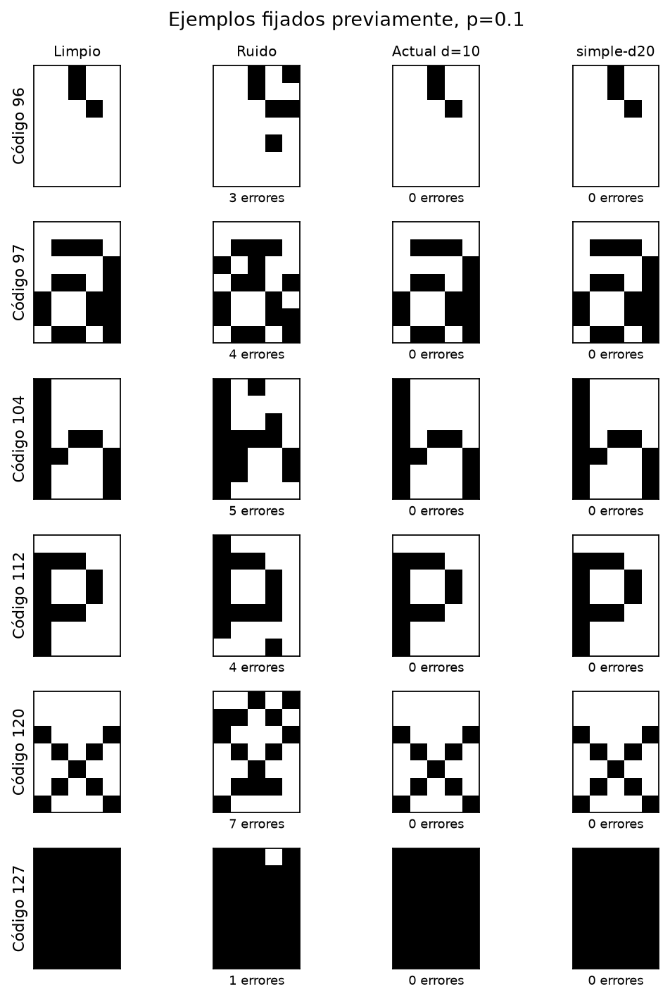
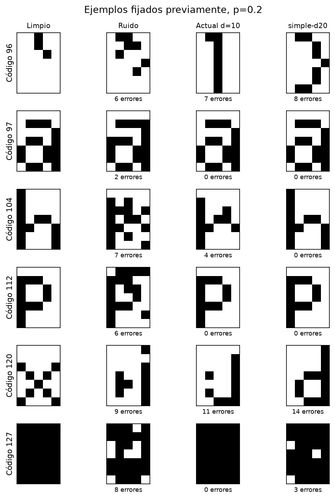

# TP5 1.b — Comparación de arquitectura y ancho central

Campaña autorizada el 2026-11-17. Diseño y criterio fijados en [el plan](../../denoising-architecture-plan.md) antes de entrenar.

## Resultado de la selección

La variante seleccionada por validación es **`simple-d20`**, arquitectura `35→40→20→20→20→40→35`. Su error medio entre semillas es **1.0135** píxeles por imagen, frente a **1.2275** de `current-d10` (17.4 % de reducción en esta validación). Corrida representativa: `simple-d20-seed-43`.

Estos puntajes promedian por igual los niveles 0,05/0,10/0,20. Cada semilla aporta su mejor checkpoint; no se escoge una arquitectura por su mejor semilla.

La seleccionada tiene menos capas, pero **5375 parámetros**, frente a 5185 de la referencia: ampliar el código también modifica el tamaño del modelo.

## Diseño y costo

| Familia | Arquitectura |
|---|---|
| Más simple (`simple`) | `35→40→20→d→20→40→35` |
| Actual (`current`) | `35→40→20→10→d→10→20→40→35` |
| Más profunda (`deeper`) | `35→40→30→20→10→d→10→20→30→40→35` |

Dimensiones centrales: 5, 10, 15 y 20; semillas: 42, 43 y 44. BCE, Adam 0,002, tanh interna, salida logística, lote 32 y 3000 épocas por corrida. Ruido por época y validación conservan exactamente el protocolo anterior.

Se completaron **36 combinaciones: 33 entrenamientos nuevos y 3 reutilizados** (`current-d10`). Consumo nuevo: **99,000 épocas**; 108.000 representadas, incluidas las 9.000 históricas. Tiempo de la fase de entrenamiento: **40.51 minutos**, incluyendo copia de corridas y guardado; no incluye preparación, evaluación ni gráficos. No hubo búsqueda adicional fuera del diseño autorizado.

## Comparación de validación

| Variante | Parámetros | Error medio | Desvío entre semillas | Mín.–máx. | Épocas elegidas (42/43/44) |
|---|---:|---:|---:|---:|---|
| simple-d20 | 5375 | 1.0135 | 0.0172 | 0.9895–1.0289 | 2900/2600/3000 |
| simple-d15 | 5170 | 1.0700 | 0.0123 | 1.0529–1.0811 | 2900/2600/2800 |
| simple-d10 | 4965 | 1.0931 | 0.0033 | 1.0885–1.0964 | 2800/2900/2800 |
| deeper-d15 | 7350 | 1.1318 | 0.0123 | 1.1199–1.1487 | 2900/2900/2800 |
| deeper-d20 | 7455 | 1.1791 | 0.0694 | 1.0906–1.2600 | 2900/2600/2800 |
| current-d20 | 5395 | 1.1903 | 0.0255 | 1.1706–1.2264 | 2900/2600/2900 |
| deeper-d10 | 7245 | 1.1928 | 0.0909 | 1.0676–1.2806 | 2800/2600/2800 |
| current-d15 | 5290 | 1.2235 | 0.0182 | 1.2003–1.2447 | 2900/2600/2700 |
| current-d10 | 5185 | 1.2275 | 0.0209 | 1.2027–1.2539 | 3000/2600/3000 |
| simple-d5 | 4760 | 1.3430 | 0.0213 | 1.3212–1.3720 | 2900/3000/2800 |
| current-d5 | 5080 | 1.3892 | 0.0810 | 1.2911–1.4896 | 3000/3000/2800 |
| deeper-d5 | 7140 | 1.4053 | 0.0700 | 1.3361–1.5012 | 2900/2900/2800 |

## Qué responde sobre las decisiones de arquitectura

- Dentro de **más simple**, el mejor ancho probado fue **20**, con 1.0135 errores de validación.
- Dentro de **actual**, el mejor ancho probado fue **20**, con 1.1903 errores de validación.
- Dentro de **más profunda**, el mejor ancho probado fue **15**, con 1.1318 errores de validación.

Manteniendo el código en **10** para comparar con la referencia, la red simple obtiene 1.0931, la actual 1.2275 y la más profunda 1.1928 errores por imagen. Esto compara profundidad a igual ancho central, aunque no iguala el número de parámetros.

En **6/36 corridas** el mejor checkpoint es el de la época 3000, el límite del presupuesto. Por eso el resultado describe rendimiento con este número de actualizaciones; no demuestra que todas las redes hayan agotado su capacidad de aprendizaje.

La búsqueda permite justificar una elección entre estas 12 variantes bajo el presupuesto de 3000 épocas. No prueba que la dimensión seleccionada sea óptima para cualquier red, otro ruido o más entrenamiento. Profundidad y cantidad de parámetros cambian conjuntamente. En `current` y `deeper` las capas vecinas siguen teniendo ancho 10: ampliar el centro a 15/20 no elimina esa compresión previa. Las tres semillas describen variación; no son una prueba de significancia estadística.

## Evaluación independiente después de seleccionar

Se generó una colección nueva con semilla **20261117**, después de congelar `selection.json`. Contiene 12.832 ejemplos: los 32 limpios y 100 realizaciones por carácter para cada nivel positivo. No participó en la selección. Las tablas siguientes promedian las tres semillas; 0,30 está fuera del rango entrenado.

| Variante | Ruido p | Error medio | Recuperación exacta | Con ≤1 error |
|---|---:|---:|---:|---:|
| current-d10 | 0 | 0.0000 | 100.00 % | 100.00 % |
| current-d10 | 0.05 | 0.1150 | 95.65 % | 97.37 % |
| current-d10 | 0.1 | 0.4912 | 84.96 % | 89.86 % |
| current-d10 | 0.2 | 3.0271 | 48.65 % | 55.73 % |
| current-d10 | 0.3 | 7.1498 | 17.88 % | 23.07 % |
| simple-d20 | 0 | 0.0000 | 100.00 % | 100.00 % |
| simple-d20 | 0.05 | 0.0660 | 96.81 % | 98.31 % |
| simple-d20 | 0.1 | 0.3500 | 87.77 % | 92.16 % |
| simple-d20 | 0.2 | 2.5997 | 48.84 % | 57.42 % |
| simple-d20 | 0.3 | 6.7122 | 15.72 % | 21.46 % |

La mejora no es uniforme en todas las métricas: con **p=0,30**, la recuperación exacta de la seleccionada es **15.72 %**, frente a **17.88 %** de la referencia. El criterio acordado prioriza error medio en los niveles entrenados, no recuperación exacta fuera de rango.

Las tablas de evaluación de las 12 variantes están en [evaluation/seed-aggregates.csv](evaluation/seed-aggregates.csv). No se cambia la selección si otra variante obtiene un mejor valor final. Esto mide recuperación de caracteres conocidos ante ruido nuevo, no generalización a caracteres desconocidos.

Los ejemplos usan siempre la primera realización de los caracteres 96, 97, 104, 112, 120 y 127, fijados antes de inspeccionar las imágenes.

## Verificaciones y reproducción

Se recalculó la validación de los **36** mejores checkpoints desde sus modelos persistidos, se comprobaron configuraciones, épocas, historias y hashes, y se verificó la selección por el criterio congelado. Los **80 archivos** de la campaña original permanecen idénticos por SHA256. Los tres modelos reutilizados conservan su procedencia y verificaron sus puntajes antes de entrenar.

Archivos principales: [protocolo](protocol.json), [manifiesto](manifest.json), [selección](selection.json), [tabla por corrida](validation-runs.csv), [tabla agregada](validation-aggregates.csv), [verificación](verification.json). Los comandos para entrenar desde cero o recalcular evaluación sin entrenamiento están en [el plan](../../denoising-architecture-plan.md). La campaña conserva copias del código principal ejecutado en `implementation/`.

Fundamento: un DAE entrena pares de entrada contaminada y objetivo limpio (OFF-022, p. 22; wiki de autoencoders del curso). La consigna PA-004 1.b pide justificar una arquitectura y estudiar niveles de ruido. Las variantes y el presupuesto de esta comparación son decisiones del grupo.

La evaluación completa se repitió desde los checkpoints sin entrenar: **19 arrays**, las **tres tablas CSV** y las métricas coinciden exactamente. Evidencia en [validation/reload-comparison.json](validation/reload-comparison.json).

La suite del TP5 pasó **40 tests**, incluidos los nuevos de diseño de grilla y rechazo de reutilización incompatible o corrupta. [Log](validation/tp5-tests.log).
