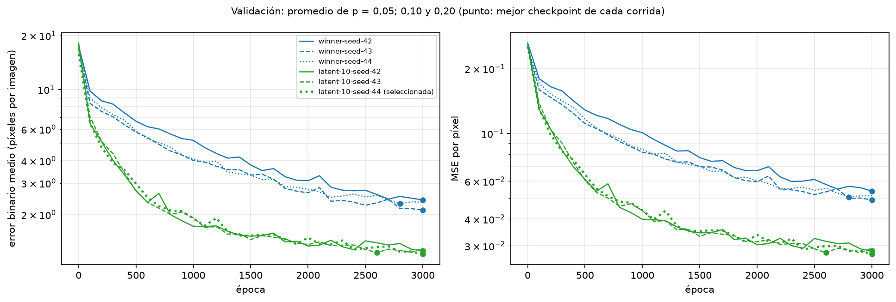
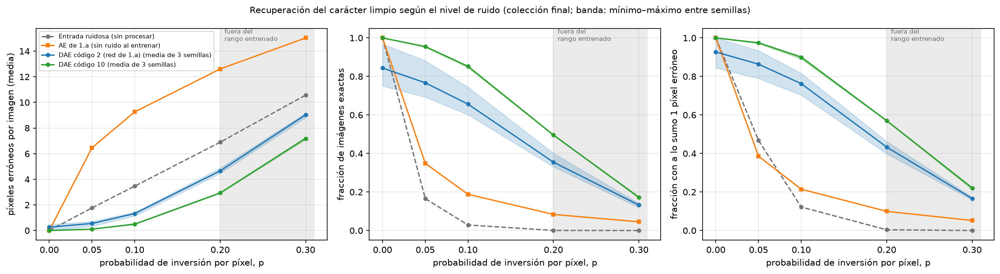
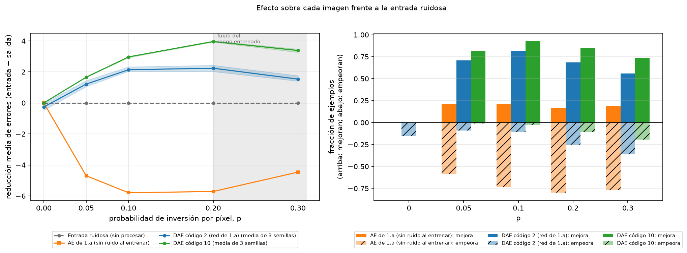
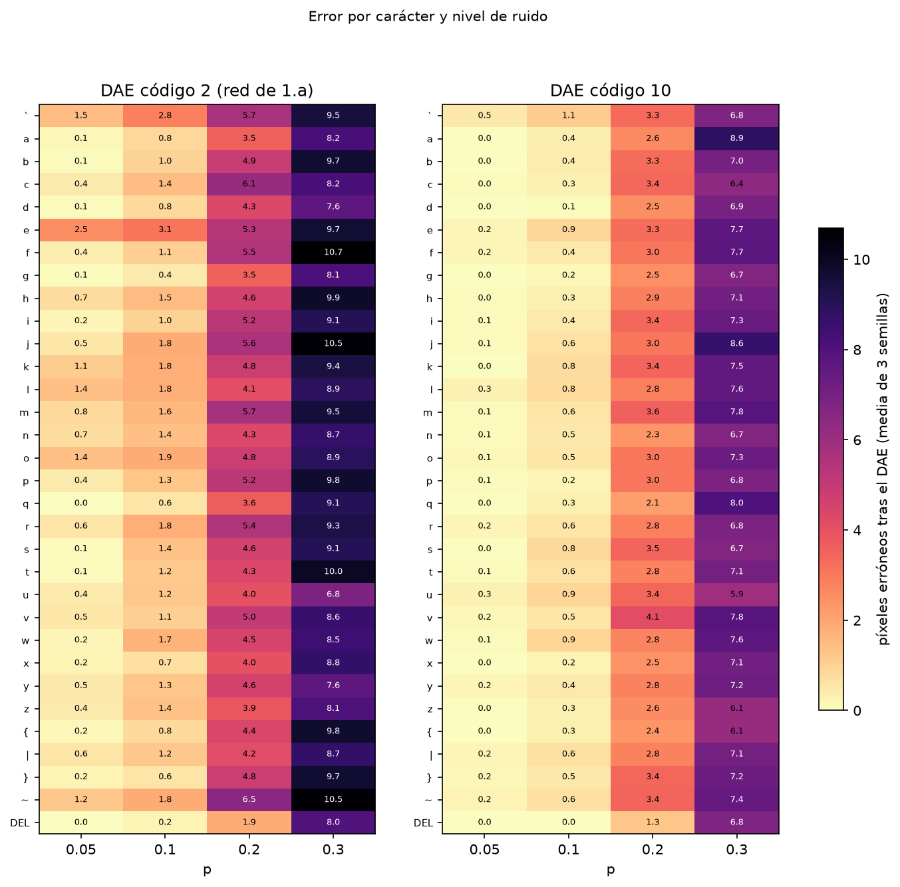

# TP5, ejercicio 1.b — Autoencoder de eliminación de ruido

Este informe responde a los dos puntos de 1.b de la consigna:

- **1.b.1.** Plantear una arquitectura conveniente para un Denoising Autoencoder
  sobre el mismo dataset y explicar la elección.
- **1.b.2.** Distorsionar las entradas en distintos niveles y estudiar la
  capacidad del autoencoder de eliminar el ruido.

Todo lo que se afirma sale de la campaña guardada en esta carpeta (seis entrenamientos y
una evaluación sobre una colección independiente). Las tablas se pueden recalcular
con los archivos de `evaluation/`, y las figuras con `src/denoise_figures.py`
(ver la sección 7). Se distingue lo que **pide la consigna**, lo que **decidió el
grupo** (acuerdos de diseño) y lo que **muestra la evidencia**.

## 1. Resumen

- Entrenar con ruido funciona. Con 10 % de píxeles invertidos, la entrada trae
  3,47 píxeles erróneos por imagen y el DAE de código 10 deja 0,50: recupera
  exactamente el 85 % de las imágenes (la entrada ruidosa solo es exacta en el 3 %).
- Un autoencoder común, sin ruido al entrenar, **empeora** el problema: con
  p = 0,10 deja 9,26 píxeles erróneos, más del doble que la entrada.
- Comparamos dos anchos del código con todo lo demás igual: 2 (la red de 1.a) y 10.
  El de **código 10 es mejor en todos los niveles y en las tres semillas**; el
  de código 2 ni siquiera reconstruye bien las imágenes limpias.
- La recuperación se degrada al subir el ruido: con p = 0,20 baja el error de
  6,89 a 2,94 píxeles y recupera el 50 % de las imágenes exactas. Con p = 0,30
  (fuera del rango entrenado) todavía reduce el error un 32 %, pero solo el 17 %
  de las imágenes queda exacto.
- Todas las imágenes de evaluación son versiones ruidosas de los mismos 32
  caracteres. Esto mide recuperación de caracteres conocidos, no generalización
  a letras nuevas.

## 2. Datos y ruido

**Dataset (consigna).** Los 32 caracteres de `font.h` (códigos `0x60` a `0x7f`),
imágenes binarias de 7×5 vectorizadas en 35 componentes. No se modificó el
archivo.

**Ruido (acuerdo del grupo; [src/noise.py](../../src/noise.py)).** Cada píxel se
invierte (0↔1) de forma independiente con probabilidad `p`. Es el ruido natural
para imágenes binarias. Con `p` el número esperado de píxeles invertidos por
imagen es 35·p:

| p | 0,05 | 0,10 | 0,20 | 0,30 |
|---|---:|---:|---:|---:|
| Píxeles invertidos (esperado) | 1,75 | 3,5 | 7 | 10,5 |

**Entrenamiento.** El par es (entrada ruidosa, objetivo limpio). En cada época, a
cada carácter se le sortea un nivel entre {0; 0,05; 0,10; 0,20} con igual
probabilidad y se invierten sus píxeles. La red no ve dos veces la misma imagen
ruidosa. Como el lote es de 32 y hay 32 caracteres, cada época es una
actualización de pesos. Se incluyó p = 0 en el sorteo (un cuarto de las imágenes
queda limpia) para que la red no pierda la capacidad de reconstruir caracteres
sin ruido.

**Validación y evaluación.** Se generaron dos colecciones fijas de 12.832
imágenes cada una: 100 versiones por carácter para cada nivel positivo
(0,05; 0,10; 0,20; 0,30) y una versión limpia por carácter (p = 0). Se usaron
semillas distintas entre sí y respecto del entrenamiento (`20261110` para validar,
`20261111` para evaluar). La colección de evaluación no participó en ninguna
decisión. El nivel 0,30 queda fuera del rango entrenado (máximo 0,20) y sirve
para ver cómo se extrapola.

## 3. Arquitectura (1.b.1)

### Las dos variantes

Heredan de la ganadora de 1.a el optimizador (Adam, tasa 0,002), la pérdida
(entropía cruzada binaria, BCE), la activación tanh en las capas internas y la
salida logística. Los pesos se entrenan desde cero. Solo cambia el ancho de la
capa central:

| Variante | Arquitectura | Qué es |
|---|---|---|
| `winner` (DAE código 2) | `35→40→20→10→2→10→20→40→35` | La red de 1.a, con código de 2 |
| `latent-10` (DAE código 10) | `35→40→20→10→10→10→20→40→35` | Igual, con código de 10 |

El nombre `winner` es el de la variante ganadora de **1.a**. En 1.b ganó
`latent-10`.

### Por qué esta elección

1. **Mismo dataset y misma base que 1.a.** Partir de la red que ya reconstruye
   los 32 caracteres sin errores evita explorar una arquitectura nueva sin
   necesidad y permite comparar con el autoencoder de 1.a.
2. **Un DAE debe llevar muchas imágenes estropeadas al mismo carácter limpio.**
   Con un código de 2 números, cada carácter ocupa un punto del plano y las
   versiones ruidosas deben caer cerca de él sin confundirse con los otros 31.
   En 1.a ya costó conseguir que 2 números alcanzaran para las imágenes sin ruido
   (más de 200 corridas de búsqueda: 180 de la campaña factorial y 43 de la
   posterior). Con ruido, el problema probablemente sea más difícil.
3. **Hipótesis a contrastar.** Con 10 dimensiones queda margen para
   separar los caracteres y absorber las perturbaciones. Se probaron ambas
   variantes, con tres semillas cada una, para que la comparación no dependa de una
   inicialización favorable. Al cambiar solo el ancho del código, el efecto se
   puede atribuir a ese cambio.
4. **Qué mostró la evidencia.** La hipótesis se confirma: ver las secciones 4.2 y
   4.3. Por esa razón se eligió el DAE de código 10.

No se probaron otros anchos (por ejemplo 4, 6 o 16), por lo que no se puede
afirmar que 10 sea el óptimo, solo que supera a 2 con la misma configuración.

### Protocolo de entrenamiento y selección

- Seis corridas: 2 variantes × semillas 42, 43 y 44. Cada una con 3000 épocas, lote 32,
  sin parar por tolerancia. Presupuesto total: 18.000 épocas, consumido
  íntegramente y sin reintentos (unos 57 segundos por corrida).
- Se evaluó la validación al inicio, cada 100 épocas y al final. El mejor
  checkpoint de cada corrida minimiza el error binario medio (píxeles erróneos
  por imagen, con umbral 0,5), promediando con igual peso los niveles 0,05; 0,10
  y 0,20. Desempata el MSE y después la época más temprana.
- Las variantes se comparan por el promedio de los mejores puntajes de sus tres
  semillas. En ese promedio `latent-10` tiene 1,23 píxeles erróneos de validación
  y `winner` tiene 2,28. La corrida representativa es `latent-10-seed-44`.

| Corrida | Mejor época | Error de validación (píxeles) | MSE de validación |
|---|---:|---:|---:|
| winner-seed-42 | 3000 | 2,416 | 0,0540 |
| winner-seed-43 | 3000 | 2,125 | 0,0490 |
| winner-seed-44 | 2800 | 2,301 | 0,0506 |
| latent-10-seed-42 | 3000 | 1,254 | 0,0284 |
| latent-10-seed-43 | 2600 | 1,226 | 0,0279 |
| **latent-10-seed-44** | 3000 | **1,203** | **0,0275** |



## 4. Resultados (1.b.2)

Los valores son los de la colección de evaluación (3200 imágenes por nivel
positivo y 32 limpias). Para los DAE se muestra la media de las tres semillas y
el rango mínimo–máximo entre corchetes. La entrada ruidosa y el AE de 1.a
tienen una sola evaluación.

### 4.1 Píxeles erróneos por imagen

| Modelo | p = 0 | p = 0,05 | p = 0,10 | p = 0,20 | p = 0,30 (fuera de rango) |
|---|---:|---:|---:|---:|---:|
| Entrada ruidosa | 0 | 1,767 | 3,466 | 6,893 | 10,568 |
| AE de 1.a | 0 | 6,463 | 9,260 | 12,606 | 15,032 |
| DAE código 2 | 0,260 [0,031–0,469] | 0,553 [0,326–0,713] | 1,327 [1,141–1,423] | 4,654 [4,465–4,869] | 9,032 [8,811–9,161] |
| **DAE código 10** | **0** [0–0] | **0,111** [0,094–0,120] | **0,500** [0,471–0,547] | **2,935** [2,886–2,966] | **7,183** [7,098–7,304] |

Reducción relativa del error del DAE de código 10 frente a la entrada: 94 %
(p = 0,05), 86 % (0,10), 57 % (0,20) y 32 % (0,30). Para el DAE de código 2 son 69 %,
62 %, 32 % y 15 %.

### 4.2 Imágenes recuperadas

| Modelo | Métrica | p = 0 | p = 0,05 | p = 0,10 | p = 0,20 | p = 0,30 |
|---|---|---:|---:|---:|---:|---:|
| Entrada ruidosa | Exactas | 1,000 | 0,166 | 0,029 | 0,001 | 0,000 |
| | ≤ 1 error | 1,000 | 0,468 | 0,122 | 0,004 | 0,000 |
| AE de 1.a | Exactas | 1,000 | 0,349 | 0,188 | 0,084 | 0,045 |
| | ≤ 1 error | 1,000 | 0,386 | 0,215 | 0,100 | 0,052 |
| DAE código 2 | Exactas | 0,844 | 0,767 | 0,656 | 0,355 | 0,132 |
| | ≤ 1 error | 0,927 | 0,864 | 0,762 | 0,433 | 0,166 |
| **DAE código 10** | Exactas | **1,000** | **0,955** | **0,852** | **0,496** | **0,173** |
| | ≤ 1 error | **1,000** | **0,974** | **0,899** | **0,570** | **0,221** |



### 4.3 Qué muestran los resultados

1. **Entrenar con ruido es lo que permite eliminarlo.** El AE de 1.a tiene la
   misma arquitectura, pérdida y optimizador que el DAE de código 2 y reconstruye
   perfectamente las imágenes limpias. Con ruido las empeora: en p = 0,10 empeora
   el 73 % de los ejemplos, y en p = 0,20 el 80 %. La comparación es casi
   controlada: además del ruido al entrenar, difieren la semilla (49 contra
   42–44) y la duración (el AE de 1.a se detuvo a las 600 épocas, al cumplir la
   tolerancia, y los DAE entrenaron 3000).
2. **El DAE de código 10 supera al de código 2 en todos los niveles.** Los rangos
   entre semillas no se solapan en ningún nivel: por ejemplo, con p = 0,20 la
   peor semilla de código 10 deja 2,966 píxeles erróneos y la mejor de código 2,
   4,465.
3. **El DAE de código 2 daña imágenes limpias.** Con p = 0 deja 0,26
   píxeles erróneos de media (hasta 0,47 según la semilla) y solo el 84 % de las
   imágenes queda exacta. El de código 10 las conserva todas.
4. **La recuperación decae con el ruido.** Con p = 0,05 y 0,10, el DAE de código
   10 recupera de forma exacta el 95,5 % y el 85,2 % de las imágenes. Con p = 0,20,
   el 49,6 %. Con p = 0,30, el 17,3 %, aunque el error medio baja de 10,6 a 7,2.
5. **Casi nunca empeora una imagen con ruido bajo.** El DAE de código 10
   empeora el 0,9 % de los ejemplos con p = 0,05 y el 2,7 % con p = 0,10, pero el
   11,1 % con p = 0,20 y el 19,3 % con p = 0,30 (el DAE de código 2 empeora el 9,2 %,
   11,2 %, 25,9 % y 36,1 % en esos niveles).
6. **Las tres semillas dan resultados parecidos.** En el DAE de código 10 el
   rango entre semillas del error medio es de 0,03 píxeles en p = 0,05 y de
   0,2 en p = 0,30.



### 4.4 Fuera del rango entrenado (p = 0,30)

El entrenamiento llegó hasta p = 0,20. Con p = 0,30 (10,6 píxeles erróneos de
media en la entrada) el DAE de código 10 reduce el error a 7,2 pero reconstruye
exactamente pocas imágenes. Una posible explicación (no verificada) es que con
tantos píxeles invertidos la imagen ruidosa se parezca más a otro carácter que
al original.

### 4.5 Por carácter



- `DEL` (todos los píxeles encendidos) es el más fácil: en el DAE de código 10,
  0,01 píxeles erróneos con p = 0,10 y 1,29 con p = 0,20. Es el patrón que se
  distingue más de los demás.
- Con ruido bajo, los más difíciles son `` ` ``, `e`, `w`, `u` y `s` (p = 0,10) y
  `v`, `m`, `s`, `~` y `k` (p = 0,20).
- Un análisis exploratorio (solo 32 puntos) muestra que con ruido bajo el
  error por carácter se asocia con la cercanía a otro carácter: en el DAE de
  código 10, la correlación de Spearman con la distancia de Hamming mínima al
  resto es −0,83 con p = 0,05 y
  −0,56 con p = 0,10, y desaparece con p = 0,30 (0,00). Los pares más cercanos
  son `l`/`|` y `r`/`n`.

### 4.6 Ejemplos

Las láminas `samples-p<nivel>.png` muestran, para el primer ejemplo de los
caracteres 0, 1, 8, 16, 24 y 31, el original, la entrada ruidosa, el AE de 1.a y
las dos variantes del DAE. Los índices se fijaron antes de ver resultados y no se
eligieron los casos favorables. Con p = 0,20 ([lámina](figures/samples-p0.2.png)),
el DAE de código 10 deja 3, 0, 3, 0, 0 y 0 píxeles erróneos en esos caracteres,
el DAE de código 2 (semilla 43) deja 7, 0, 10, 8, 9 y 0, y el AE de 1.a deja 13,
22, 22, 8, 17 y 0. El resto de las láminas está en [figures/](figures/).

## 5. Limitaciones

- **Solo caracteres conocidos.** Cada imagen de evaluación es una versión
  ruidosa de uno de los 32 caracteres de entrenamiento. Se mide cuánto del
  carácter original se recupera, no si el modelo funciona con letras nuevas.
- **Dos anchos y tres semillas.** Solo se comparó el código de 2 con el de 10. El
  optimizador y la tasa se heredaron de 1.a, ajustados para un autoencoder sin ruido
  de código 2, y no se reoptimizaron para el DAE.
- **Presupuesto fijo.** Cuatro de las seis corridas eligieron como mejor
  checkpoint la última época (3000) y la validación todavía bajaba (por ejemplo, de
  1,427 a 1,254 entre las épocas 2500 y 3000 en `latent-10-seed-42`). Es posible que
  más épocas mejoren ambas variantes. No se probó porque el protocolo no
  autorizaba ampliar el presupuesto.
- **Un solo tipo de ruido.** Solo inversión independiente de píxeles. No se
  estudió ruido estructurado ni otros tipos.
- **Selección con validación propia.** El nivel 0,30 y el nivel 0 no intervinieron
  en la selección. No se eliminaron posibles coincidencias casuales entre
  imágenes de las colecciones, por lo que su independencia es estadística.
- **Análisis por carácter exploratorio.** La correlación con la distancia de
  Hamming se calculó sobre 32 caracteres y no sustituye una prueba controlada.

## 6. Conclusiones

1. Un autoencoder entrenado con ruido (inversión de píxeles hasta 20 %) elimina una
   parte importante del ruido de caracteres de 7×5, mientras que uno entrenado sin
   ruido lo amplifica.
2. La arquitectura elegida, con las capas de la red de 1.a y un código de 10
   dimensiones, supera a la de código 2 con el mismo protocolo y en las tres
   semillas: conserva las imágenes limpias y recupera de forma exacta el 85 % de
   las imágenes con 10 % de ruido.
3. La recuperación disminuye al aumentar el ruido: 50 % de imágenes exactas con
   20 % de ruido y 17 % con 30 %, nivel que no se entrenó.
4. Con el protocolo acordado no se puede afirmar que 10 dimensiones sea el
   ancho óptimo, ni que el rendimiento se mantenga con letras nuevas o con ruido de otro
   tipo.

## 7. Reproducción y verificación

Desde `tp5/`, con Python 3.10 o posterior y las dependencias de `requirements.txt`:

```bash
python -m src.denoise_figures --campaign results/denoising --output results/denoising/figures-nuevo
python -m unittest tests.test_denoise_figures -v
```

- Las figuras y las tablas salen de `evaluation/by-level.csv`,
  `evaluation/by-character.csv`, `evaluation/seed-aggregates.csv`,
  `collections/final.npz`, `selection.json` y las historias de `runs/`.
  `figures/figures-manifest.json` registra las corridas mostradas y los SHA256
  de las entradas.
- Comprobaciones hechas al preparar este informe: los hashes de la referencia, las
  colecciones, los seis checkpoints y los archivos de evaluación coinciden con los
  registrados, y las métricas de `by-level.csv` se recalcularon desde las
  predicciones guardadas sin diferencias. `evaluation/` y `evaluation-reloaded/`
  tienen arrays idénticos, y `verification.json` registra el recálculo de la
  validación al recargar los modelos.
- Entorno de la campaña: Python 3.14.4 y NumPy 2.4.4.
- Volver a entrenar (`python -m src.denoise train`) consume otro presupuesto de
  18.000 épocas. Además requiere los cambios del MLP de TP3 que usa `src/autoencoder.py`
  (pérdida BCE, latente lineal y scheduler), que hoy no están en el repositorio.
  Evaluar y graficar no los necesita.
- Procedencia de la referencia de 1.a: modelo `confirmation-finalist-seed-49`
  (arquitectura `35→40→20→10→2→10→20→40→35`, BCE, Adam 0,002), SHA256
  `e39ab072ed146e11a337d82e5f625a775d8cc73628d90355746a8ece653fa85e`.
  Protocolo y esquemas de archivos: [denoising-data.md](../../denoising-data.md).
